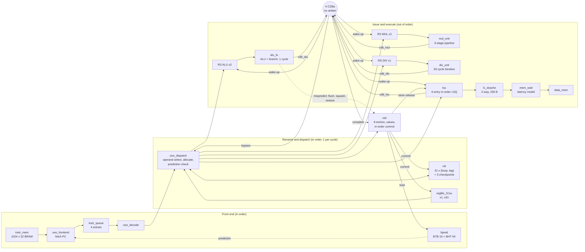

<div align="center">

# TOMA-RV

**A Tomasulo-style out-of-order RV32IM processor with speculative execution, an L1 data cache and a live multi-core comparison platform, implemented on a Nexys A7-100T FPGA**

`Verilog-2005` · `RV32IM` · `Artix-7 xc7a100tcsg324-1` · `50 MHz` · `Icarus Verilog / Vivado 2025.2`

</div>

---

## Abstract

TOMA-RV is a single-issue, out-of-order RISC-V core built next to a course-supplied 3-stage in-order RV32I pipeline. Its design follows Tomasulo's algorithm, extended with a reorder buffer (ROB) for precise, in-order retirement. Instructions are renamed through a register alias table whose tags are ROB entry numbers. They wait in per-unit reservation stations and complete on **four dedicated common data buses (CDBs), one per functional unit, with no arbitration**. On top of this baseline machine the core adds:

- branch speculation, with a BTB and a bimodal predictor and checkpoint-based recovery at branch resolution;
- a configurable 2-way L1 data cache;
- a parameterised slow-memory model;
- a UART console and boot loader;
- a board top that runs four cores side by side on the same program and shows their cycle counts and speed-up ratios live on the 7-segment display.

The design is verified with self-checking unit testbenches and constrained-random whole-core tests against an ISA model. Every committed instruction of 22 programs is compared against an independent Python reference model in many hardware configurations. Bug-injection campaigns check that the tests actually catch faults. The single-core system routes on the Artix-7 at 50 MHz with positive slack and uses 18.5 % of the device's LUTs.

The evaluation is deliberately honest. The baseline pipeline has full forwarding and single-cycle on-chip memory, so out-of-order execution has little latency to hide on integer code. The core wins clearly where independent multi-cycle work can overlap: **2.03×** on a multiply stream and **1.39×** on mixed multiply/divide. It loses on short, branchy or memory-bound programs. Both outcomes are reported below.

---

## Contents

1. [Highlights](#1-highlights)
2. [Microarchitecture](#2-microarchitecture)
3. [Design decisions and their justification](#3-design-decisions-and-their-justification)
4. [Configuration parameters](#4-configuration-parameters)
5. [System integration: memory map, board tops, UART](#5-system-integration)
6. [Verification methodology](#6-verification-methodology)
7. [Results](#7-results)
8. [Repository layout](#8-repository-layout)
9. [Getting started](#9-getting-started)
10. [Scope](#10-scope)
11. [Team](#11-team)
12. [References](#12-references)

---

## 1. Highlights

| | |
|---|---|
| **ISA** | RV32I subset of the course baseline (36 instructions) **plus all 8 RV32M instructions**; AUIPC available behind a decoder parameter; anything else retires as a NOP and raises a sticky `exception` flag |
| **Core** | Single-issue in-order dispatch, out-of-order issue and completion, in-order commit (1 per cycle) |
| **Window** | 8-entry ROB (parameterised; 4 / 8 / 16 evaluated), RS: ALU ×3, MUL ×2, DIV ×1; 4-entry load/store queue; 4-entry instruction queue |
| **Broadcast** | 4 CDBs (`cdb_alu`, `cdb_mul`, `cdb_div`, `cdb_lsu`), **no arbiter, zero broadcast stalls by construction** |
| **Functional units** | 1-cycle ALU/branch · 3-stage pipelined multiplier (4 DSP48) · 33-cycle radix-2 restoring divider · in-order LSU |
| **Speculation** | 16-entry tagged BTB + 64-entry 2-bit bimodal table; up to 3 unresolved branches, each with a RAT checkpoint; recovery at resolve |
| **Memory** | 256 B 2-way L1 D-cache (write-back/write-allocate by default, write-through selectable), 1-cycle hits; optional slow-memory model with a write buffer |
| **System** | MMCM 50 MHz core clock, MMIO result/done/switches/buttons/cycle counter, 115200-baud UART, UART boot loader, 12 hardware performance counters (selectable on the 7-segment display) |
| **Comparison platform** | One bitstream with in-order and out-of-order cores running the same program; speed-ups computed and displayed on the board |
| **FPGA** | Routed at 50 MHz on `xc7a100tcsg324-1`: WNS **+1.250 ns**, WHS +0.034 ns; 11,735 LUTs (18.5 %), 7,790 FFs (6.1 %), 1 BRAM, 4 DSP |

---

## 2. Microarchitecture

### 2.1 Block diagram



The core is wrapped in `pipe_ooo`, which keeps **exactly** the port list of the course baseline `pipe`. The same testbenches and board tops can therefore drive either core.

### 2.2 Life of an instruction

| Stage | What happens | Timing |
|---|---|---|
| **Fetch** | `fetch_pc` addresses the 1-cycle BRAM. The predictor is looked up in the same cycle and steers the next PC. The word and its prediction are written into the instruction queue. | fetch in *t*, queued in *t*+1 |
| **Decode / dispatch** | The queue head is decoded combinationally. Dispatch reads the RAT, the architectural register file and the ROB, allocates a ROB entry, an RS/LSQ entry and (for a branch) a RAT checkpoint, and renames `rd`. One instruction per cycle, in order. | earliest *t*+2 |
| **Operand capture** | For each source: `x0` → 0; RAT not busy → ARF; producer's ROB entry ready → ROB value; producer broadcasting **this cycle on any of the 4 buses** → bypass; otherwise wait on its tag. | same cycle as dispatch |
| **Wake-up / issue** | Each RS operand compares its tag against all four buses every cycle. Among the ready entries, the oldest issues. | issue from *W*+1 after a broadcast in *W* |
| **Execute / broadcast** | ALU: execute and broadcast in one cycle. MUL: start *t*, broadcast *t*+2, one start per cycle. DIV: start *t*, broadcast *t*+33. Load: address cycle, then data (1 cycle on a hit). Store: broadcasts once address and data are known. | per unit |
| **Commit** | The ROB head retires when ready: write the ARF, clear the RAT entry if it still names this tag, release a store to memory, train the predictor, latch a pending exception. One per cycle. | ≥ *W*+1 |
| **Recovery** | A mispredicted branch triggers a registered flush in the following cycle. The ROB computes a squash mask of all younger entries and rewinds its tail. RS/LSQ entries, MUL pipeline stages, the divider and any in-flight load with squashed tags are killed. The RAT is restored from the branch's checkpoint, and fetch restarts at the correct PC. | resolve *X*, flush *X*+1 |

### 2.3 Structures and sizes

| Structure | Entries | Contents |
|---|---|---|
| ROB | `ROB_N` = 8 | valid, ready, kind (value/store/branch), has_rd, rd, value[31:0], pc[31:0], branch outcome, mispredict, exception |
| RAT | 31 (x1–x31) | busy, tag[`ROB_W`-1:0]; plus `BR_CKPT_N` = 3 full snapshots |
| RS ALU / MUL / DIV | 3 / 2 / 1 | busy, op[7:0], tag, (qj_valid, qj, vj), (qk_valid, qk, vk), a, age |
| LSQ | 4 | busy, is_store, funct3, tag, base (q, v), store data (q, v), imm, store-broadcast flag |
| Instruction queue | 4 | pc, instruction, predicted-taken, predicted target |
| BTB / BHT | 16 / 64 | tag, target, unconditional flag / 2-bit saturating counters |
| L1 D-cache | 2 ways × 8 sets × 4 words | data, 5-bit tag, valid, dirty per line; 1 LRU bit per set |

All widths are written with the `ooo_defs.vh` parameters (`[ROB_W-1:0]`, `[NCDB*ROB_W-1:0]`) and every bus consumer is a `for` loop over `NCDB`. As a result, the ROB-size sweep in §7.3 needed no RTL edits beyond the two defines.

---

## 3. Design decisions and their justification

The decisions below were recorded in the project's decision log before or during implementation. Each states the choice, the reason for it, what it costs, and where the evidence is.

### 3.1 Tags are ROB entry numbers

**Choice.** A renamed register points at the ROB entry of its youngest in-flight writer. RS operands wait on ROB indices, and results are stored in the ROB until commit (ROB-based renaming, as in the P6 family), rather than in a separate physical register file.

**Why.** An index is unique for an instruction's whole lifetime, so no tag allocator, free list or reclamation logic is needed. The tag is only `ROB_W` = 3 bits wide, which keeps every CDB comparator small. Recovery reduces to "invalidate ROB entries younger than *X*", which is a subtraction of indices relative to the head.

**Cost.** A squashed ROB index is reused immediately. Any squashed instruction still inside a functional unit would then complete the *new* instruction in that entry. Every unit is therefore flushed by tag on recovery: both MUL stages, the divider (which aborts) and the in-flight load. A simulation monitor in `rob.v` reports any broadcast to an unallocated entry.

### 3.2 Four CDBs, one per functional unit, no arbiter

**Choice.** Each functional unit owns its bus. Every consumer (each RS operand, each LSQ operand, the ROB's four write ports and the dispatch bypass) listens to all four buses in parallel.

**Why.** Each unit can produce at most one result per cycle: one ALU issue per cycle, one MUL start per cycle, one divide at a time. Simultaneous completions therefore never conflict, and **broadcast stalls are zero by construction**. Removing the arbiter also removes it from the critical wake-up loop (RS select → ALU → `cdb_alu` → RS capture). It removes result buffering inside the units, and it makes forward progress easy to argue: the oldest instruction's unit always has a free bus. The only shared bus is `cdb_lsu` (loads and store completions). The LSU itself never starts an operation whose broadcast would collide, so this is internal scheduling, not arbitration between units.

**Cost.** Every waiting operand needs `NCDB` = 4 tag comparators and a 4:1 capture mux, and the ROB needs four write ports. At this size (8 ROB entries, 10 RS/LSQ entries) that cost is small. This is a deliberate departure from the single CDB of the classic algorithm.

### 3.3 Small, parameterised window: ROB 8, RS 3/2/1, LSQ 4

**Choice.** `ROB_N` = 8. ALU ×3 (branches also use the ALU stations), MUL ×2, DIV ×1, LSQ ×4.

**Why.** With one dispatch and one commit per cycle, the window only has to cover the latency of the longest common operation. The 2-entry MUL station matches a pipelined multiplier that accepts one operation per cycle. A single DIV station matches a single non-pipelined divider, because a second entry could only queue. The ALU station count also bounds the number of unresolved branches, because a branch occupies an ALU station until it resolves. That is why the RAT holds exactly `BR_CKPT_N = RS_ALU_N` = 3 checkpoints.

**Evidence.** The ROB-size sweep in §7.3 shows diminishing returns. Going from 4 to 8 entries saves 3.2 % of cycles on the workload set (9.3 % on stress programs). Going from 8 to 16 saves only 0.7 % (4.6 %), while each extra entry adds about 80 bits of ROB state, and doubling the ROB widens every tag.

### 3.4 Dispatch operand priority and the same-cycle bypass

**Choice.** The source priority is `x0` → ARF (RAT not busy) → ROB value (entry ready) → **any CDB carrying the tag this cycle** → wait.

**Why.** If a producer broadcasts in the same cycle that a consumer dispatches, the consumer would otherwise record a tag that will never be broadcast again and wait forever. The four-bus bypass closes this race. It is the only combinational path from the buses into dispatch, and it gives dependent ALU instructions back-to-back execution, matching the baseline's forwarding.

### 3.5 RAT update rule

**Choice.** At commit, a RAT entry is cleared **only if it still holds the committing tag**. A same-edge allocation to the same register wins over the clear. `x0` is never renamed.

**Why.** The RAT must always name the *youngest* writer. A blind clear at commit would expose a stale ARF value to an instruction whose true producer is still in flight. Every checkpoint applies the same commit rule ("snooping"), so it is still correct when it is restored many cycles later.

### 3.6 Precise state: only commit changes architectural state

**Choice.** The ARF, data memory, MMIO side effects, conditional-branch predictor training and the `exception` flag change only at commit.

**Why.** This makes speculation safe by construction. A wrong-path instruction can compute, broadcast and fill RS entries, but it can never write memory, train the branch predictor or report a false exception. Wrong-path fetches do reach illegal words, which is why the exception flag is latched at commit and not at dispatch.

### 3.7 Conservative, in-order memory ordering

**Choice.** Loads and stores share one in-order queue. A store writes memory only in its commit cycle. A load starts only when it is at the queue head, which means every older store has already committed. MMIO loads additionally wait until they are the oldest instruction in the machine.

**Why.** The core needs no address-disambiguation CAM, no store-to-load forwarding and no memory-order violation recovery. Memory consistency is correct by construction and simple to verify. MMIO reads can have side effects: reading the UART data register removes a byte. A wrong-path MMIO load must therefore never reach the device.

**Cost.** A load cannot bypass an older store to a different address. Load bypass with an address check was scoped as a stretch goal and not built.

### 3.8 Stores must never block commit

**Choice.** A store broadcasts its completion only when the cache is idle. Between that broadcast and its commit it stays at the head of the LSQ, so no other access can start in between.

**Why.** The ROB has no back-pressure path: a ready store commits in the cycle it reaches the head. This rule guarantees the cache can always accept the committed write in that exact cycle, without adding stall logic to the commit path. A simulation assertion in `l1_dcache.v` flags any request made while the cache is stalled.

### 3.9 Branch speculation with resolve-time recovery

**Choice.**

- **Predictor:** a 16-entry tagged, direct-mapped BTB and a 64-entry 2-bit bimodal table, looked up in the fetch cycle.
- **Check at dispatch:** dispatch checks every prediction against the decoded instruction, which fixes a stale BTB target or a "taken" non-branch immediately.
- **Check at resolve:** conditional branches are checked again when they resolve.
- **Recovery:** recovery happens at branch resolution, one cycle later, from registered flush signals.
- **Training:** conditional branches train the BTB and counters only at commit. JAL targets, a static property of the instruction, are learned at dispatch.
- **JALR:** JALR is not predicted; dispatch holds until it resolves.

**Why.**

- *Recovery at resolve rather than at commit* shortens the misprediction penalty by the time the branch would spend waiting to reach the ROB head.
- *The registered flush* keeps the ALU comparison out of the large fan-out squash network in one cycle. This is a timing decision for 50 MHz on an Artix-7.
- *Training conditional branches at commit* means wrong-path branches cannot pollute the tables.
- *A prediction is only a hint*: every target is re-verified. A corrupted predictor can cost cycles but cannot change architectural results, and the verification exploits this (§6).
- *JALR is not predicted* because none of the target workloads has a hot indirect jump, and a return-address stack would add a second recovery structure for no measured gain.

**Cost.** The checkpoints, the squash mask and the fetch-stage BTB lookup add area and timing pressure. The routed result (§7.6) shows they fit at 50 MHz with +1.25 ns of slack.

### 3.10 Functional-unit choices

| Unit | Choice | Justification |
|---|---|---|
| ALU / branch | Execute and broadcast in the issue cycle | Dependent integer chains run at one per cycle, like the forwarding baseline. JALR's link value `pc+4` travels in the RS `vk` field and returns on `cdb_alu`, so the ROB treats every bus write the same way. |
| Multiplier | 3-stage pipeline, one 33×33 signed product for all four variants | Sign-extending each operand by one bit covers MUL/MULH/MULHSU/MULHU with one datapath. It maps onto 4 DSP48 slices, as confirmed by the routed design, and accepts a new operation every cycle. |
| Divider | Radix-2 restoring, **fixed 33-cycle latency**, `busy` low in the done cycle | Data-independent latency makes scheduling a single `~busy` check and keeps timing diagrams to one picture. Dropping `busy` in the done cycle removes a dead cycle between back-to-back divides. RISC-V corner cases (÷0, INT_MIN/−1) are handled without traps. |
| Register file | 31 × 32 flip-flops, 2 read / 1 write, no write-through | Reset to zero for deterministic simulation. Any bypass belongs to the rename logic, which keeps the module trivial to verify. |

### 3.11 L1 data cache

**Choice.** 2 ways × 8 sets × 16 B lines (256 B), with an LRU bit per set and 1-cycle hits. Write-back/write-allocate is the default; write-through/no-write-allocate is a compile-time option. Tags cover only the 12 address bits that `data_mem` decodes, and MMIO bypasses the cache.

**Why.**

- *Write-back is the default* because write traffic costs cycles on slow memory. The sweep in §7.4 shows write-back winning from about 5 wait cycles upward.
- *Narrow tags* make addresses that alias in `data_mem` (for example the stack at `0xFFFF_Fxxx` and `0x0000_0xxx`) share one cache line, so the cached system sees exactly the memory the uncached one does.
- *`stall` is a registered output*, so the cache adds no combinational path back into the LSU.

**An honest finding.** With the on-chip `data_mem`, which already answers in one cycle, a cache cannot improve CPI: a hit only ties the old timing and a miss costs more. That observation motivated the slow-memory model (§3.12). Against that model the cache is decisive (§7.4–7.5).

### 3.12 A latency model for off-chip memory

**Choice.** `mem_wait` sits between the core and `data_mem`:

- each non-sequential access costs `MEM_WAIT` extra cycles (default 10);
- the next sequential word is free, like a DRAM burst;
- accesses are served one at a time;
- a 4-entry write buffer drains before reads.

It uses the baseline's previously unused `dmem_read_valid` / `dmem_write_valid` handshake inputs, so the `pipe_ooo` port list did not change.

**Why.** The FPGA's block RAM is far faster, relative to the core, than the memory a real core sees. Without a slow memory, caching and latency tolerance cannot be studied at all. **The wait value is a model chosen by the designers, not a measurement of the board**, and all results that use it say so.

### 3.13 Port compatibility with the baseline

**Choice.** `pipe_ooo` keeps the baseline `pipe` port list exactly. Debug and performance signals are added as extra outputs, and the reset stays active-low and asynchronous on every module, as in the baseline.

**Why.** The OoO core, the baseline and its RV32M extension (`pipe_m`) plug into the *same* testbench harness, the same memories and the same MMIO and counter logic. Every performance comparison is then made under identical conditions with an identical "done" definition.

### 3.14 Measurement methodology

- **Cycle counting.** Cycles are counted from reset release to the edge that latches the MMIO `done` store, inclusive, by the same `perf_counters` block on every core.
- **Which baseline.** The original baseline `pipe` cannot run RV32M. It is compared only on RV32I programs. RV32M workloads are compared against `pipe_m`, an in-order RV32IM version of the baseline built for exactly this purpose, which uses the same MUL/DIV units.
- **Out-of-order evidence.** `ooo_count` counts committed instructions that finished while an older instruction was still waiting. Counting at commit keeps wrong-path completions out of the statistic.

### 3.15 Clocking and reset on the board

**Choice.** An MMCM generates the 50 MHz core clock. The board top uses a two-flip-flop reset synchroniser with asynchronous assert and synchronous release, and all user inputs pass through two-flip-flop synchronisers.

**Why.** The original course board top divided the clock down to 1 Hz from a counter, and its CPU logic was never timed. A real generated clock makes the timing report meaningful. 50 MHz was fixed early as a conservative target for the single-cycle wake-up/execute loop. The final speculative design still meets it with +1.25 ns of slack.

---

## 4. Configuration parameters

Every option is a define in `ooo_rtl/ooo_defs.vh` and can be overridden on the command line (for example `iverilog -DDC_WB=0 -DMEM_WAIT=5`). The speculation, cache, memory-wait and ROB-size options were all exercised in the configuration sweeps of §6.

| Define | Default | Meaning |
|---|---|---|
| `ROB_N` / `ROB_W` | 8 / 3 | ROB entries / tag width (`ROB_N` = 2^`ROB_W`) |
| `NCDB` | 4 | Number of result buses: one per functional unit, so fixed by the unit mix |
| `RS_ALU_N`, `RS_MUL_N`, `RS_DIV_N`, `LSQ_N`, `IQ_DEPTH` | 3, 2, 1, 4, 4 | Structure sizes |
| `SPEC_EN` | 1 | 0 = no speculation: dispatch holds after every branch until it resolves |
| `BTB_N` / `BHT_N` | 16 / 64 | Predictor sizes (powers of two) |
| `DC_EN` | 1 | 0 = no cache; the LSU talks to memory directly |
| `DC_WAYS`, `DC_SETS`, `DC_WORDS` | 2, 8, 4 | Associativity (1 or 2), sets per way, words per line (4 or 8) |
| `DC_WB` | 1 | 1 = write-back/write-allocate, 0 = write-through/no-write-allocate |
| `MEM_WAIT` | 10 | Extra cycles per non-sequential data-memory access (0 = `data_mem` as is) |
| `MEM_WBUF_N` | 4 | Write-buffer entries in `mem_wait` |

---

## 5. System integration

### 5.1 Memory map

Instruction and data memories are 1024 words each (4 KiB). The region with `addr[31:28] = 4'h1` is memory-mapped I/O. **MMIO stores never write `data_mem`**: the RAM decodes only `addr[11:2]` and would otherwise alias the I/O addresses onto real data.

| Address | Access | Function |
|---|---|---|
| `0x1000_0000` | store | Program result (per byte lane), shown on LEDs and display |
| `0x1000_0004` | store | `done`: stops all counters; cleared only by reset |
| `0x1000_0008` | load | Slide switches `{16'd0, sw}` |
| `0x1000_000C` | load | Push buttons `{27'd0, C, R, L, D, U}` |
| `0x1000_0020` | load | UART status: [0] byte waiting, [1] can send, [2] input lost |
| `0x1000_0024` | load / store | Next received byte (the read removes it) / send a byte |
| `0x1000_0028` | load | Cycle counter (the `cycles` performance counter), for timing a code region |

### 5.2 Board tops

| Top | Contents |
|---|---|
| `top_fpga_ooo` | The OoO core with MMCM, memories, `mem_wait`, MMIO, UART, boot loader, 12 performance counters and the 7-segment display. `led[15]` = done, `led[14]` = exception, `led[13:0]` = result. Switches select the value shown: result, cycles, retired instructions, `ooo_count`, cache accesses/hits/misses/stall cycles, branches, mispredicts. |
| `top_fpga_cmp` | The comparison platform. Four cores run the same program from the same reset edge, each with its own memories, MMIO and counters: **`pipe_m`** (in-order RV32IM, 1-cycle memory), **OoO fast** (1-cycle memory), **OoO slow** (the default slow memory) and **`pipe_m` slow** (the baseline on the same slow memory). The OoO cores are built with 16 physical ROB entries; switches select an active ROB size of 4, 8 or 16 at reset. The display shows any counter of any core, CPI, hit rate, mispredict rate, and **speed-up ratios on fast and on slow memory**, in hex or decimal (`cmp_display` divides and converts with a small sequential engine). The in-order baseline cannot wait for memory, so its slow-memory instance runs on a glitch-free gated clock (`BUFGCE`) that is held while memory is busy. This gives a fair comparison on identical memory without modifying the baseline. |
| `top_fpga_base` | The baseline `pipe` or `pipe_m` in the same board environment, for reference builds |

### 5.3 UART console and boot loader

`uart.v` implements 115200 baud, 8N1, with 16-byte receive and transmit FIFOs. Programs use it through the MMIO registers above.

`uart_loader` replaces the program **without a new bitstream**:

1. Hold **BTNC** while releasing **CPU_RESET**. The core stays in reset and the board replies `BOOT`.
2. Send a frame: `"TRV1"`, the code and data word counts, the code words, the data words, then a 32-bit checksum.
3. The loader fills instruction and data memory and zeroes the rest.
4. If the checksum matches, the board replies `OK` and the core starts at PC 0. A bad frame gets `ERR` and the core stays held, so a corrupted transfer never runs.

In `top_fpga_cmp` every write goes to all four cores, which then start on the same clock edge.

---

## 6. Verification methodology

Every functional claim in this README is backed by a self-checking test that prints `TEST_PASS <module> <checks>` or `TEST_FAIL` with the cycle, expected and actual values. Waveforms were used for debugging, never as evidence. The regression (`simulation/run_unit_tests.sh`) writes one log per test under `evidence/`, recording date, tool version, exact command, commit, exit status and simulated cycles.

### 6.1 Layers

| Layer | Testbenches | Method |
|---|---|---|
| **Unit** | `tb_alu_fu`, `tb_rs_array`, `tb_rob`, `tb_rat`, `tb_lsu`, `tb_mul_unit`, `tb_div_unit`, `tb_regfile_2r1w`, `tb_instr_queue`, `tb_ooo_decode`, `tb_ooo_dispatch`, `tb_bpred`, `tb_l1_dcache`, `tb_mem_wait`, `tb_perf_counters`, `tb_uart` | Directed corner cases plus large random streams against behavioural models. The decoder is checked on 200k random words against the ISA's MATCH/MASK table. The divider is checked against vectors from an independent Python RV32M model. The cache is checked against a golden memory **and** a cache-state model that predicts every hit or miss, write-back, exact load latency and bus transfer. |
| **Multi-unit** | `tb_alu_path`, `tb_ooo_frontend`, `tb_ooo_event_trace` | Cycle-exact scenarios. These include the multi-bus cases: two operands released in one cycle by two different buses, and several buses broadcasting in one cycle. |
| **Whole core** | `tb_ooo_core`, `tb_ooo_core_spec` | A directed program plus **60 constrained-random 300-instruction RV32IM programs**. Every commit, every store and the final register file are compared against an ISA model inside the testbench. Out-of-order completion and multi-bus cycles are counted. |
| **System / ISA** | `tb_commit_trace` (×6 builds), `tb_top_fpga_ooo`, `tb_baseline_counters` | The real board top runs 22 programs: the course's original program, 6 hand-written edge-case and overlap tests, 7 gcc-compiled C workloads and 8 generated speculation-stress programs. **Every committed instruction** (pc, rd, value, store) is compared against `tools/ref_model.py`, an independent instruction-level RV32IM model. |
| **I/O** | `tb_uart_system`, `tb_uart_live`, `tb_uart_loader`, `tb_buttons`, `tb_top_fpga_cmp` | Bytes are driven serially into the `uart_rx` pin and every output byte is compared with the reference model. The boot loader is checked through the pins. The comparison board checks every core, counter by counter, every cycle, against its single-core equivalent, and checks all 128 display settings. |

### 6.2 Techniques beyond directed tests

- **Configuration sweeps.** The commit-trace suite passes with identical results across 30 combinations of speculation on/off, no cache / write-through / write-back, and memory wait 0–20, and across ROB sizes 4, 8 and 16.
- **Predictor chaos.** A build option (`SPEC_CHAOS`) randomly corrupts the predictor while programs run. Results must not change, which tests the claim that a prediction is only a hint.
- **Bug injection.** Deliberately broken RTL copies check that the tests detect real faults. **18 of 18** speculation bugs were caught: missing MUL/DIV/load kill, RAT restore, checkpoint upkeep, ROB/RS/LSQ squash, flush ordering, recovery address, exception timing. So were **5 of 5** cache bugs, **14 of 14** UART bugs and 3 of 3 comparison-board bugs. A first stress generator missed two MUL-kill bugs, which led to adding late-resolving branches to it.
- **In-RTL protocol monitors** (simulation only). These flag broadcasts to unallocated ROB entries (stale tags), cache requests while stalled, and memory-wait protocol violations. Each prints `TEST_FAIL`, so a passing regression means none fired.
- **Toolchain gate.** `tools/check_elf.py` rejects gcc output the core cannot run: compressed instructions, unsupported opcodes, and relocations whose encoded offsets are not exactly right. Its own test suite has 22 synthetic ELF cases and a cross-check against the decoder on 26k words.

### 6.3 Status

On the integrated design tree, under Icarus Verilog 12.0, the regression passes every unit, multi-unit, whole-core, system, boot-loader and comparison-board test above. It passes all six commit-trace builds and all five UART-system builds, and the live UART session in its default, chaos, write-through and no-cache builds. `tb_ooo_core` checks 15,161 commits of its directed and random programs against its ISA model. `tb_commit_trace` compares 13,065 committed instructions against the reference model in each configuration. A 16×16 matrix multiply of 198,009 instructions also matches the reference model commit by commit in ten configurations.

---

## 7. Results

All cycle counts are from simulation of the RTL (Icarus Verilog 12.0), counted as described in §3.14. The board tops are the simulated designs, so cycle counts are deterministic and do not depend on the clock frequency.

### 7.1 Out-of-order core vs in-order RV32IM baseline (same memory)

`pipe_m` is the in-order 3-stage baseline extended with the same MUL and DIV units. Both cores use 1-cycle data memory. OoO uses the default build (speculation on, write-back L1). "OoO slow" is the same core on the 10-wait-cycle memory model.

| Program | Kind | Retired | `pipe_m` | OoO | Speed-up | OoO slow | `ooo_count` |
|---|---|---:|---:|---:|---:|---:|---:|
| `mul_stream` | 32 independent MULs | 52 | 120 | 59 | **2.034** | 59 | 0 |
| `muldiv_stream` | DIV + 7 independent MULs, ×4 | 56 | 248 | 178 | **1.393** | 178 | 19 |
| `ooo_trace` | hand-built overlap scenario | 14 | 55 | 52 | 1.058 | 52 | 5 |
| `rv32m_edge` | RV32M corner cases | 74 | 554 | 539 | 1.028 | 539 | 21 |
| `div_d8` | C, divide loop | 102 | 516 | 548 | 0.942 | 578 | 4 |
| `rv32m_d8` | C, mixed RV32M | 119 | 273 | 290 | 0.941 | 320 | 14 |
| `base_rv32i` | RV32I coverage loop | 310 | 408 | 438 | 0.932 | 448 | 19 |
| `mul_d8` | C, multiply loop | 78 | 108 | 126 | 0.857 | 146 | 3 |
| `sort_d8` | C, bubble sort | 127 | 147 | 199 | 0.739 | 219 | 2 |
| `top_mmio` | MMIO / board test | 92 | 147 | 211 | 0.697 | 262 | 5 |
| `addition_d8`, `negative_d8`, `xor_d8` | C, 18 instructions | 18 | 22 | 34 | 0.647 | 54 | 1 |

**Interpretation.**

- **Where the gain comes from.** On `mul_stream`, `ooo_count` = 0, so the 2.03× comes from the **pipelined multiplier accepting one MUL per cycle** against `pipe_m`'s freeze per MUL, not from out-of-order completion. On `muldiv_stream` it does come from completion order: 19 multiplies complete behind a running divide. With 8 ROB entries, at most 7 instructions can be hidden behind a 33-cycle divide.
- **Why the OoO core loses elsewhere.** On integer and memory code the in-order baseline has full forwarding, no data-hazard stalls and single-cycle memory, so there is no latency to hide. Meanwhile the OoO machine pays for a longer front end (queue → decode → dispatch), conservative load ordering and cold cache misses. These results agree with the expectation written into the project plan before any RTL existed: RV32I-only code would see no benefit against this baseline.

### 7.2 Speculation

Without a cache, at memory wait 0, speculation reduces total cycles on the 13-program set by **4.2 %** (2,736 → 2,620). It cuts `base_rv32i` from 517 to 431 cycles (−17 %). On generated loop-heavy stress programs, which are **not** typical workloads, it cuts cycles by 18 %. Prediction accuracy is 83 % on the stress programs (2,480 branches) and **94 %** on the 16×16 matrix multiply (295 mispredicts in 4,930 branches). Speculation can also hurt: a wrong-path load occupies memory until it finishes, which costs `top_mmio` 9 cycles.

### 7.3 ROB size sweep

Default build (speculation, write-back L1), 1-cycle memory. Every configuration passes the full commit-trace comparison.

| ROB entries | 13 workloads, total cycles | vs 8 | 8 stress programs, total cycles | vs 8 |
|---:|---:|---:|---:|---:|
| 4 | 2,829 | +3.2 % | 30,349 | +9.3 % |
| **8 (default)** | **2,742** | — | **27,767** | — |
| 16 | 2,722 | −0.7 % | 26,488 | −4.6 % |

Programs that overlap divides benefit most from the larger window (`muldiv_stream` 194 → 178 → 169, `rv32m_edge` 571 → 539 → 528). Most C workloads are unchanged from 8 to 16. This supports `ROB_N` = 8 as the cost/benefit point for a single-issue machine.

### 7.4 Memory hierarchy and speculation on slow memory

Total cycles on 13 programs as the memory wait grows:

| Memory wait | Spec off, no cache | Spec off, write-back | Spec on, no cache | Spec on, write-through | **Spec on, write-back** |
|---:|---:|---:|---:|---:|---:|
| 0 | 2,736 | 2,863 | 2,620 | 2,677 | 2,742 |
| 2 | 3,148 | 2,908 | 3,010 | 2,726 | 2,787 |
| 5 | 3,786 | 2,974 | 3,650 | 2,868 | 2,853 |
| **10 (default)** | 4,906 | 3,084 | 4,833 | 3,116 | **2,963** |
| 20 | 7,193 | 3,304 | 7,185 | 3,696 | 3,183 |

- At the default wait of 10 cycles, the default build needs **40 % fewer cycles** than the same core without cache or speculation. Almost all of that comes from the cache.
- The cache starts to pay off at about 2 wait cycles. At 0 it costs cycles, as §3.11 explains.
- Write-back overtakes write-through at about 5 wait cycles. That result is why the default policy is write-back.

### 7.5 A larger kernel: 16×16 integer matrix multiply

198,009 committed instructions, verified commit by commit against the reference model:

| Configuration | Cycles | CPI |
|---|---:|---:|
| `pipe_m`, 1-cycle memory | 216,065 | 1.091 |
| OoO, speculation, no cache, 1-cycle memory | 218,243 | 1.102 |
| OoO, speculation, write-through, 1-cycle memory | 239,940 | 1.212 |
| OoO, speculation, no cache, **10-cycle memory** | 786,552 | 3.972 |
| OoO, default (speculation, write-back), **10-cycle memory** | **312,704** | **1.579** |

On slow memory the cache cuts execution time by 60 % (91.4 % hit rate). On fast memory the OoO core essentially matches the in-order baseline on this load/MUL mix.

### 7.6 FPGA implementation

`top_fpga_ooo` (OoO core with speculation, L1 cache, memory model, UART, boot loader, counters, display), Vivado 2025.2, `xc7a100tcsg324-1`, post-route:

| Metric | Value | Device share |
|---|---:|---:|
| Core clock (MMCM) | 50 MHz | — |
| Worst negative slack (setup) | **+1.250 ns** | all constraints met |
| Worst hold slack | +0.034 ns | — |
| Slice LUTs | 11,735 | 18.51 % |
| Slice registers | 7,790 | 6.14 % |
| Block RAM tiles | 1 | 0.74 % |
| DSP48E1 | 4 | 1.67 % |

For reference, the course baseline occupied 2,368 LUTs and 1,296 flip-flops and ran from a 1 Hz divided clock that was never timed. The design was routed and programmed onto a Nexys A7-100T.

---

## 8. Repository layout

```
tomasulo-rv/
├── ooo_rtl/            All new RTL
│   ├── ooo_defs.vh       shared parameters and encodings (single source of truth)
│   ├── pipe_ooo.v        baseline-compatible wrapper
│   ├── ooo_core.v        core integration: units, 4 CDB vectors, recovery, debug outputs
│   ├── ooo_frontend.v    fetch, redirect, hold        instr_queue.v   4-entry fetch queue
│   ├── bpred.v           BTB + bimodal predictor      ooo_decode.v    RV32IM decoder
│   ├── ooo_dispatch.v    rename, operand select, allocate, prediction check
│   ├── rat.v             register alias table + checkpoints
│   ├── rob.v             reorder buffer, commit, squash mask, ooo_event
│   ├── rs_array.v        reservation stations (oldest-ready select)
│   ├── alu_fu.v          ALU and branch unit          mul_unit.v      3-stage multiplier
│   ├── div_unit.v        33-cycle divider             lsu.v           load/store queue
│   ├── l1_dcache.v       L1 data cache                mem_wait.v      slow-memory model
│   ├── regfile_2r1w.v    architectural register file  perf_counters.v 12 counters
│   ├── top_fpga_ooo.v    single-core board top        memory.v        BRAM-backed memories
│   ├── top_fpga_cmp.v    comparison board top         cmp_slice.v     one core of it
│   ├── cmp_display.v     hex/decimal/ratio display    cmp_clkgate.v   glitch-free clock gate
│   └── uart.v, uart_loader.v, instr_mem_wr.v          UART, boot loader, writable imem
├── ooo_tests/          self-checking testbenches tb_<module>.v
│   └── programs/         test programs (.s/.hex), disassembly and reference traces
├── modules/            course baseline 3-stage RV32I pipeline (reference, unmodified)
├── baseline_m/         pipe_m: the baseline extended to in-order RV32IM
├── baseline_fpga/      baseline board tops and constraints
├── ooo_fpga/           Vivado batch flow, programming script, constraints
├── simulation/         regression runner, cycle measurement, Vivado xsim Makefile
├── mem_generator/      C workloads and the gcc → hex flow
├── tools/              reference model, assembler, ELF checker, vector/program generators
└── evidence/           regression logs and design notes
```

---

## 9. Getting started

### 9.1 Prerequisites

- **Simulation:** Icarus Verilog ≥ 12 and Python ≥ 3.8 (standard library only). Vivado `xvlog/xelab/xsim` is also supported through `simulation/Makefile`.
- **C workloads (optional):** a RISC-V GCC toolchain (`riscv64-unknown-elf-gcc` or `riscv-none-elf-gcc`).
- **FPGA:** Vivado (developed with 2025.2) and a Digilent Nexys A7-100T.

### 9.2 Run the regression

```bash
cd tomasulo-rv
bash simulation/run_unit_tests.sh a                 # all tests; one log per test in evidence/
bash simulation/run_unit_tests.sh a tb_rob tb_rat   # selected tests only
```

A single test by hand, for example the RAT:

```bash
mkdir -p build
iverilog -g2012 -I ooo_rtl -o build/tb_rat ooo_rtl/rat.v ooo_tests/tb_rat.v && vvp build/tb_rat
```

### 9.3 Measure a program on all cores

```bash
bash simulation/measure_cycles.sh ooo_tests/programs/sort_d8.hex
# prints cycles, retired instructions and ooo_count for pipe / pipe_m / pipe_ooo,
# cache statistics, and the speed-up ratios
```

Any configuration can be simulated by adding defines, for example `-DSPEC_EN=0`, `-DDC_EN=0`, `-DDC_WB=0`, `-DMEM_WAIT=20` or `-DDC_WAYS=1`.

### 9.4 Reference model and your own programs

```bash
python3 -I tools/ref_model.py ooo_tests/programs/sort_d8.hex -o sort.trace   # golden commit trace
python3 -I tools/rvasm.py my_test.s -o my_test.hex                          # assemble RV32IM
make -C mem_generator sort_d8          # build a C workload (RV32I); use <name>_d8_im for RV32M
```

### 9.5 Build and program the FPGA

```bash
# single OoO core, with the program image baked into instruction memory
vivado -mode batch -source ooo_fpga/synth_vivado.tcl -tclargs bit ooo_tests/programs/sort_d8.hex ooo
vivado -mode batch -source ooo_fpga/program_board.tcl
```

The third argument selects the design: `ooo`, `pipe_m`, `pipe` or `cmp` (the comparison board). The flow stops on a missing memory image, an inferred latch or negative slack. Press **CPU_RESET** to run. To load a different program without rebuilding, use the UART boot loader (§5.3).

---

## 10. Scope

The design deliberately excludes the following, so that the core stays verifiable within the project's time frame:

- no traps, interrupts or CSRs (unsupported instructions retire as NOPs and set a sticky flag);
- no indirect-branch or return-address prediction;
- no load bypass past older stores;
- no instruction cache, because the instruction BRAM already answers in one cycle;
- single issue.

Each of these is a natural next step, and the parameterised structures and four-bus wake-up network were written to make wider configurations a matter of sizing rather than redesign.

---

## 11. Team

TOMA-RV was designed and built by a five-person team at IIT Guwahati as a hardware-laboratory course project, 9 October – 10 November 2026. Each member owned and verified a set of hardware modules.

| | Member | Responsibilities |
|---|---|---|
| A | **Ayush Sanjay Raigandhi** (technical lead) | Architecture and interfaces (`ooo_defs.vh`), register alias table and checkpoints, dispatch and rename, core integration and speculation recovery, `pipe_ooo`, integration verification |
| B | **Ayush Mishra** | Reorder buffer and commit, load/store unit, L1 data cache, memory-latency model, Vivado synthesis and implementation flow |
| C | **Arham Bakliwal** | Reservation stations, ALU/branch unit, front end and fetch, branch predictor, speculation stress testing |
| D | **Vejella Durga Suhas** | Decoder, instruction queue, multiplier, in-order RV32IM baseline `pipe_m`, comparison board and display, C workloads |
| E | **Mumuksh Patel** | Register file, divider, performance counters, single-core board top and MMIO, UART and boot loader, reference model and evidence |

---

## 12. References

1. R. M. Tomasulo, "An Efficient Algorithm for Exploiting Multiple Arithmetic Units," *IBM Journal of Research and Development*, vol. 11, no. 1, pp. 25–33, 1967.
2. J. E. Smith and A. R. Pleszkun, "Implementing Precise Interrupts in Pipelined Processors," *IEEE Transactions on Computers*, vol. 37, no. 5, pp. 562–573, 1988.
3. J. E. Smith, "A Study of Branch Prediction Strategies," *Proc. 8th International Symposium on Computer Architecture (ISCA)*, pp. 135–148, 1981.
4. J. K. F. Lee and A. J. Smith, "Branch Prediction Strategies and Branch Target Buffer Design," *IEEE Computer*, vol. 17, no. 1, pp. 6–22, 1984.
5. J. L. Hennessy and D. A. Patterson, *Computer Architecture: A Quantitative Approach*, 6th ed., Morgan Kaufmann, 2017 (Ch. 3, instruction-level parallelism).
6. A. Waterman and K. Asanović (eds.), *The RISC-V Instruction Set Manual, Volume I: Unprivileged ISA*, RISC-V International.
7. Digilent, *Nexys A7 Reference Manual*; AMD/Xilinx, *7 Series FPGAs Clocking Resources User Guide* (UG472).
